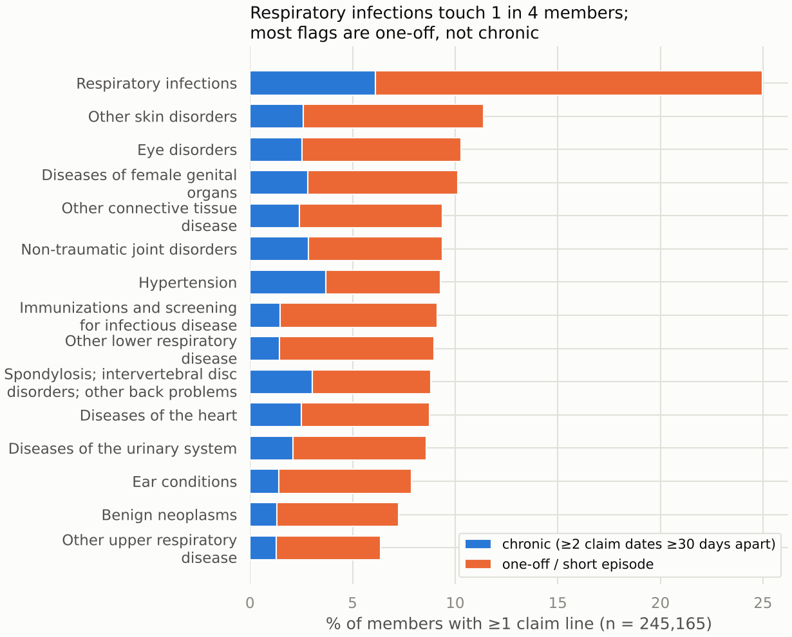
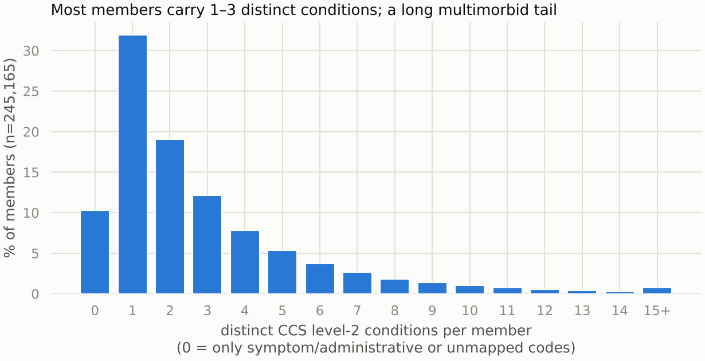

# Characterizing member health status from outpatient claims

Requirement 1 of the case study. Every number here reproduces from
`scripts/build_health_status.py` and `scripts/report_figures.py` at this commit.

## TL;DR

I characterize each member's health status as the set of CCS level-2 conditions on their
claims, each flagged chronic (coded on ≥2 claim dates ≥30 days apart) or one-off, plus
simple utilization counts; the whole thing reads back as one sentence per member. Of the
245,165 members with usable claims, 35.1% (86,155) have at least one chronic condition,
54.6% (133,785) have only one-off conditions, and 10.3% (25,200) never received a
diagnosis outside symptom/administrative codes. The median member has 2 distinct
conditions (p90 = 6, max = 85); respiratory infections are the most widespread condition
(25.0% of members) and hypertension the most widespread chronic one (3.7% chronic, 9.3%
with any code). Cleaning cost 62 of 1,919,983 rows and one member, and 99.89% of kept
rows map to CCS. These flags become the labels for requirement 2: 194,289 of these
members also appear in the prescription data.

## Approach & why

- Unit of analysis: the member. All shares below are % of the 245,165 members with ≥1
  usable claim line, not % of rows.
- Condition vocabulary: CCS level 2 (136 categories). Level 1's 18 chapters are too
  coarse to be useful ("has a circulatory problem"); level 3 (281 values) mostly restates
  level 2 at this data's volume. Level 2 is where "cancer" and "broken leg" live.
- Chronic vs one-off, per condition. A diagnosis on a claim means a clinician coded it
  that day, not that the member has the disease; single occurrences include rule-outs and
  screenings. I flag a member's condition chronic when it appears on ≥2 distinct claim
  dates ≥30 days apart. Everything else stays a one-off or short episode. Both count as
  conditions; only the flag differs.
- Two chapters never become conditions: "Symptoms; signs; and ill-defined conditions and
  factors influencing health status" (which includes the Z-codes) and the Residual
  chapter. They are tracked per member as utilization context instead. This is the most
  consequential choice in the analysis: "Factors influencing health care" alone would
  otherwise be the #1 "condition", covering 132,116 members (53.9%), more than double
  actual respiratory infections. A characterization that leads with "had an
  administrative encounter" is not useful.
- Unmapped codes get an explicit bucket: they stay in the utilization counts, never
  become conditions, and are never silently dropped.
- Ruled out: a single severity score (members have several things at once; a score hides
  which ones), utilization-only clustering (not clinically readable), and level-3 flags
  (too sparse to be robust).

## Findings

The population splits into four readable groups. Denominator: 245,165 members with ≥1
usable claim line.

| group | members | share |
|---|---|---|
| ≥1 chronic condition | 86,155 | 35.1% |
| one-off conditions only | 133,785 | 54.6% |
| symptom/administrative codes only | 25,200 | 10.3% |
| unmapped codes only | 25 | 0.01% |

Prevalence is broad but mostly non-chronic. Respiratory infections touch 25.0% of
members, yet only 6.1% of members meet the chronic rule for them. Among high-prevalence
conditions, hypertension has the largest chronic share: 39.9% of the 22,760 members with
a hypertension code (9.3% of all members) meet the chronic rule. Diabetes without
complication reaches 11,577 members (4.7%), 4,075 of them chronic.

Condition burden is concentrated. The median member has 2 distinct conditions; 10% of
members have 6 or more; the maximum is 85. That long tail is the "highly unusual care
patterns" the brief says this profiling should surface, and vignette B below is the
85-condition member.

The characterization round-trips to a sentence. Three members picked by deterministic
rules in the build script (ids masked here; the script prints them):

- Member A (cancer + injury, the shape of the brief's own example): chronic cancer of
  lymphatic and hematopoietic tissue and lower gastrointestinal disorders; one-off
  injuries from external causes and headache/migraine; 10 claim days from 2016-05 to
  2018-02, 2 of them symptom/administrative.
- Member B (most multimorbid): 66 chronic conditions (cerebrovascular disease, heart
  disease, anxiety disorders, joint disorders, and more) and 19 one-offs across 319 claim
  days from 2015-01 to 2017-01, 98 of them symptom/administrative, then nothing for the
  last two years of the window.
- Member C (healthy-ish): one one-off connective-tissue code on a single claim day in
  2018-03, nothing else.

Data quality, counted. From 1,919,983 claim rows I excluded 24 with null service dates
and 38 dated 1899–2014 (sentinels and strays), keeping 1,919,921 rows; this drops exactly
one member, whose only claim is from 2014. After ICD-10 normalization (strip dots,
uppercase), 99.89% of kept rows map to CCS. The 2,071 unmapped rows span 217 distinct
codes and are dominated by obvious junk: `99999` (1,561 rows), `KHDX` (103), `000` (61).
Claims volume ramps up from 2015-09, peaks in 2016, and runs through 2018-12.

## Limitations

- Censoring. There is no enrollment table: a member with no claims in year 3 may be
  healthy or gone. Member B's two silent years are unreadable without enrollment spans.
- The chronic rule is a heuristic. Thirty-day repetition can promote a long acute episode
  (fracture follow-ups) to "chronic"; injuries are the main false-positive risk.
- Preventive care counts as a condition. "Immunizations and screening for infectious
  disease" (9.1% of members) sits in the Infectious chapter; it is really preventive
  utilization, and I would re-bucket it with more time.
- Only one diagnosis per row. The data carries a single `diag1` and no procedures or
  financials, so severity beyond code repetition is invisible.
- Synthetic data, with deliberate dirt. Real claims would add coding-practice drift the
  simulation may not model.

## What more time buys (ranked)

1. Re-bucket preventive/screening categories out of conditions; the immunization
   category is the one clear misfit in the top 15.
2. Severity within condition: claim-day counts, recency weighting, and chapter-level
   rollups, so "member had cancer" can carry "actively treated" vs "history of".
3. Stress-test the chronic rule: persistence curves for known chronic categories
   (hypertension, diabetes) vs known acute ones (fractures), to pick a better threshold
   than the 30-day default.
4. Infer enrollment spans from claim gaps to get member-month denominators and soften
   the censoring problem.
5. Requirement 2: train the rx-only model against these flags (next milestone).

## Open questions

- Is there an enrollment/eligibility table anywhere? Absence-of-claims is ambiguous
  without it.
- Is `diag1` the primary diagnosis only? Secondary diagnosis codes would densify chronic
  detection considerably.
- Claims are near-absent before 2015-09 while prescriptions start 2013-12. Is the claims
  feed truncated, or did coverage genuinely start then?
- What are `99999` and `KHDX`? They look like feed placeholders worth fixing upstream
  (1,664 rows between them).

## Appendix — reproduction

- Pipeline: `scripts/build_health_status.py` → `data/processed/member_conditions.parquet`
  (687,620 member×condition rows), `member_health_status.parquet` (245,165 rows),
  `health_status_stats.json` (every number above). Policy constants live in
  `src/oscar_cs/health_status.py`; the queries in `sql/claims_clean_mapped.sql`,
  `sql/member_conditions.sql`, `sql/member_summary.sql`.
- Figures: `scripts/report_figures.py`. Palette checked for colorblind separation and
  surface contrast before rendering.
- Tests: `tests/test_health_status.py` covers chronic-rule edge cases and a SQL↔Python
  parity check on the chronic expression.
- Vignette member ids are masked above (real-PHI habits on synthetic data); the build
  script prints the real synthetic ids, selected by deterministic rules.
- Prescription linkage: 240,735 members in the rx table; 194,289 of the 245,165
  characterized members appear in both (one member of the documented 194,290 overlap was
  excluded with their only, pre-window claim). The ~46k rx-only members have no
  claims-based status; they are the members requirement 2's model would score.
