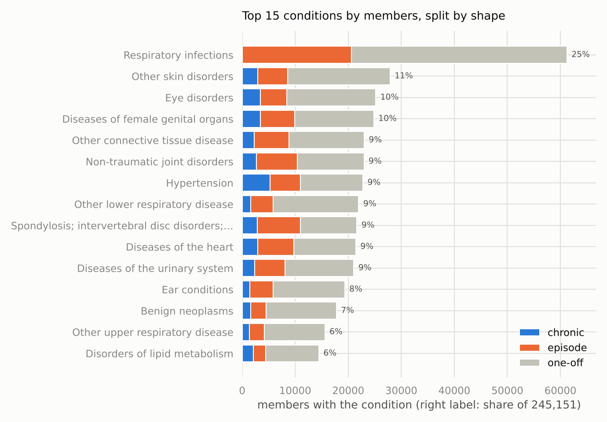
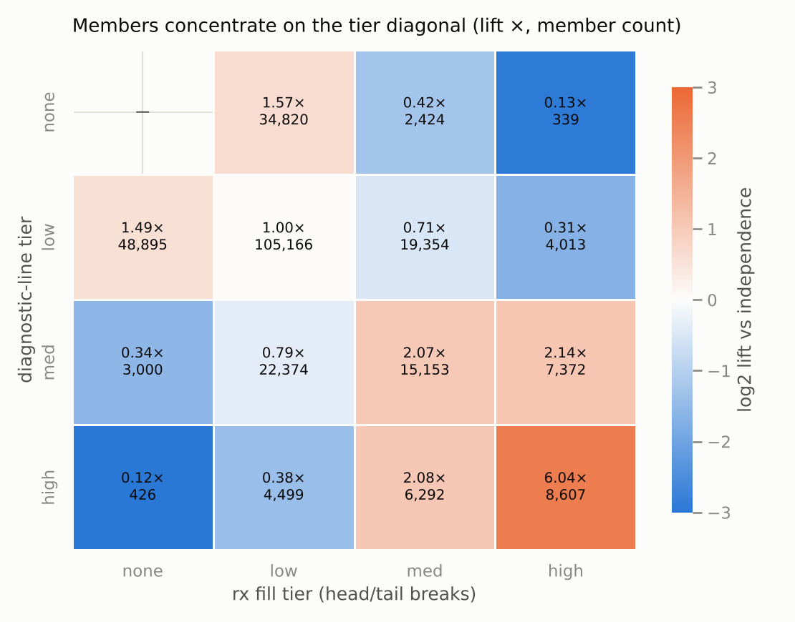
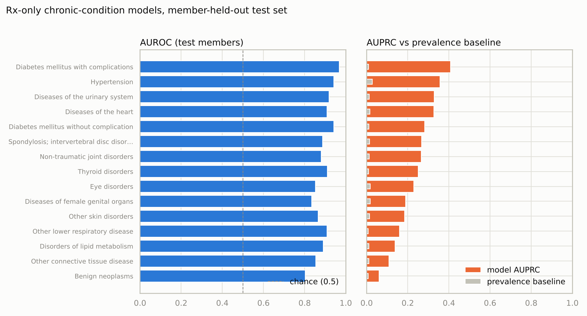
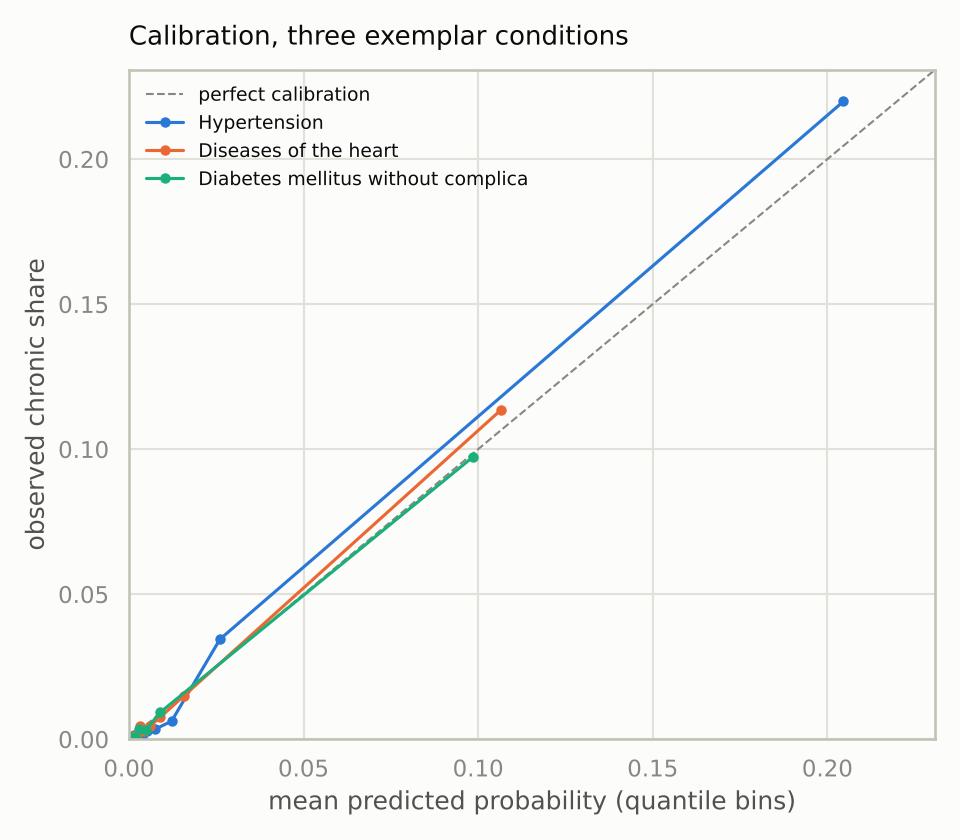

# Classifying member health status from medical and prescription drug usage

*Lauren Jackson · Oscar Health data science case study · 2026-11-02*

## 1. Summary

- **How I define health status:** each member is a set of clinical conditions from their
  claims, and each condition is tagged by its pattern over time as one-off, episode, or
  chronic. Symptoms are tracked separately, and administrative codes don't count as
  conditions.
- **Most members are light users around a chronic core.** 15.2% of the 245,151 members
  with claims have at least one chronic condition. The typical member has 2 conditions
  and 4 claim lines over almost three years.
- **Prescriptions alone recover chronic status well.** A simple model per condition ranks
  a member who has the condition above one who doesn't 80% to 97% of the time, and its
  flagged lists are 8 to 41 times more precise than random picks. It works best for
  conditions managed with drugs, such as diabetes, hypertension, and thyroid disease.
- **The model learns the drugs, not just the volume.** For 14 of 15 conditions, knowing
  which drugs a member fills makes the flagged lists 2 to 5.8 times more precise than
  knowing only how much they fill.
- **Use it to rank members, not to label them.** For the 37,583 members with
  prescriptions but no claims, a ranked list per condition is reliable (for example,
  about 242 expected members with chronic hypertension). A yes/no cutoff isn't.
- **Two groups are worth a closer look:** 4,941 members with symptoms but no diagnosed
  condition, and 765 members who are heavy users of one data feed but absent from the
  other. They are candidates for two uses the brief names: members not getting needed
  care, and unusual care patterns.

## 2. Approach and methodology

### The framework at a glance

1. **Clean the data and fix the time window,** counting every exclusion.
2. **Sort every diagnosis line** into a condition, a symptom, or an excluded
   administrative line.
3. **Give each member's conditions a shape** (one-off, episode, chronic) from the spread
   of their claim dates.
4. **Tier each member's volume** of claims and prescriptions as none, low, medium, or
   high, and flag the top 1%.
5. **Train one prescription-only model per chronic condition** and grade it on members
   it never saw.
6. **Test the model against a volume-only version,** then score the members who have
   prescriptions but no claims.

### How I define health status

A member's health status has five parts:

- **Conditions:** the clinical categories in their claims. I map ICD-10 diagnosis codes
  to CCS (Clinical Classifications Software, a standard grouping of diagnosis codes) at
  its middle level, which has about 135 categories such as "Hypertension" and
  "Fractures."
- **A shape for each condition,** from the member's distinct claim dates for it:
  - **One-off:** a single date.
  - **Episode:** two or more dates within 180 days, like a fracture and its follow-up
    visits.
  - **Chronic:** dates spread over more than 180 days, whether ongoing or recurring.
  - **Exception:** infections and injuries never count as chronic. Repeat respiratory
    infections, for example, are reinfection, not chronic disease. Viral infection is
    exempt because HIV and hepatitis sit inside that category.
- **Symptoms, tracked separately.** R-codes (symptoms and signs such as abdominal pain
  or fatigue) could mean something, but they aren't diagnoses.
- **What doesn't count:** Z-codes (checkups, screenings, and administrative contact),
  immunizations and screening, the unclassified Residual chapter, and codes with no CCS
  match. Each is counted, and none is silently dropped.
- **Utilization:** tiers for claim lines and prescription fills, plus a flag for the top
  1% of each.

Put together, a member reads as a sentence: *"Member A: chronic blood cancer and chronic
lower GI disorder, one-off migraine and one-off injury, symptoms on 1 day, 10 claim days
from 2016-05 to 2018-02."*

### Why I made these calls

- **CCS middle level.** The top level (18 chapters) hides which condition a member has,
  and the bottom level splits one condition into sparse categories. The middle level is
  specific enough to read and common enough to count.
- **Shapes instead of the standard chronic rule.** The usual rule (two claims at least
  30 days apart) counts short bursts of care as chronic. In my exploration, 44% of what
  it flagged were bounded sequences like a fracture plus follow-ups.
- **180 days as the line.** Fracture follow-ups cluster within weeks, while diabetes,
  hypertension, and thyroid check-ins recur every 60 to 92 days. A 180-day span
  separates the two.
- **Infections and injuries capped at episode.** Without this, reinfections read as
  chronic disease. The rule moved 11,091 member-condition pairs from chronic to episode,
  8,600 of them respiratory infections. The cost is that tuberculosis and spinal cord
  injury can never read chronic.
- **Z-codes excluded.** Left in, they would be the most common "condition," touching
  52.9% of members.
- **Symptoms as their own track.** A symptom visit is followed by a prescription fill
  within a week almost as often as a diagnosis visit (48.1% vs 51.8%), so symptoms carry
  real signal. Dropping them would hide members who seek care without getting a
  diagnosis.
- **Head/tail breaks for tiers.** Claim and fill counts have a long tail and pile up at
  small values, so median and quartile cuts collapsed into near-empty or duplicate
  bins. Head/tail breaks cut at the mean, then at the mean of everyone above it. The
  cuts land at 7.8 and 20.9 claim lines, and at 11.7 and 31.9 fills.
- **Remove nobody.** The extreme tail is a real group, not noise: 518 members are in the
  top 1% of both claims and fills, against about 20 expected by chance. I flag the top
  1% instead of trimming it.
- **Ruled out:** a single severity score (hides which conditions), clustering on volume
  alone (not clinically readable), and standard outlier cutoffs (they would flag about
  10% of members in tails this long).

### Data and cleaning

- **Sources:** the three files from the brief. These are claim lines with one diagnosis
  per member per day (1,919,983 rows), the CCS mapping (72,167 rows), and filled
  prescriptions with a drug category, group, and class (3,005,934 rows).
- **Window: 2015-09-01 to 2018-06-04,** where both feeds have real coverage. Claims
  start in September 2015, prescriptions reach back to December 2013, and both taper off
  over April and May 2018. The apparent claims end date of December 2018 is six stray
  rows.
- **Members:** 282,734 in the window. 192,830 appear in both feeds, 52,321 only in
  claims, and 37,583 only in prescriptions. Part 1 covers the 245,151 members with
  usable claims.
- **Cleaning, with every exclusion counted:**
  - 231 claim rows dropped (24 with no date and 207 outside the window, including 1899
    placeholder dates), which removes 15 members.
  - Diagnosis codes normalized (dots removed, uppercase) before joining to CCS, which
    maps 99.9% of rows.
  - 1,990 rows with no CCS match (216 codes, mostly junk such as `99999`, `KHDX`, and
    `000`) kept as their own bucket.
  - All codes read as text, because drug codes have meaningful leading zeros.

### How I set up the AI agent and repo

I ran this case study with Claude Code as an analyst pair. Most of my effort went into
the setup, so the agent works like a careful teammate:

- **An operating manual (`CLAUDE.md`)** with the brief, a verified data contract
  (schemas, row counts, known errors), and 12 mistakes specific to this dataset that the
  agent must avoid. Examples: joining codes before normalizing them, splitting train and
  test by row instead of by member, and letting claims leak into the prescription model.
- **Memory across sessions.** Each session starts blank, so the agent writes what it
  learns to memory files as it goes: data quirks, lessons, decisions with the
  alternatives rejected, my preferences, and a handoff note for the next session.
- **I keep the decisions.** Choices that are mine are left as marked blanks the agent may
  not fill. It brings evidence and a recommendation, I make the call, and it logs the
  call.
- **Rules as automation.** Hooks re-apply the core rules at every session start and after
  every document write, such as a plain-language editing pass on anything a person will
  read.
- **Skills for judgment.** Anthropic's data plugin covers exploration, SQL, and statistics, and a
  custom healthcare-claims skill covers this case (chronic-condition rules of thumb, how
  to treat Z-codes, which drugs point to which conditions).
- **The right model for the task.** Claude Opus 5.5 at maximum effort for brainstorming
  and planning, and Claude Fable 5 at maximum effort for writing and reviewing code.
- **Everything verifiable.** Every number comes from committed scripts and SQL that I can
  run myself, and unit tests pin the core rules.

## 3. Results and findings

### Part 1: Health status from claims

**Setup**

- I applied the definition to the 245,151 members with usable claims: 1.51 million
  condition lines, about 97,000 symptom lines, and about 313,000 excluded lines.
- That produced 665,225 member-condition pairs, each with a shape.
- Tiers and the top-1% flag cover all 282,734 members in the window, so members who
  appear in only one feed are included.

**Finding 1: Most members are light users around a chronic core.**

- 41.5% have only one-off conditions.
- 31.5% have at least one episode but nothing chronic.
- 15.2% have at least one chronic condition.
- 9.8% have only administrative or unmatched lines, and 2.0% have only symptoms.
- Conditions per member: median 2, 90th percentile 6, maximum 84.

**Finding 2: The most common conditions aren't the most chronic, and shape is what
separates them.**

- Respiratory infections reach the most members (25%), but none of it is chronic.
- Hypertension reaches 9.3% of members and has the largest chronic group, at 5,223
  members.
- Without shapes, the prevalence table reads like an urgent-care log. With them,
  long-running conditions stand out, and the drug-managed ones such as hypertension and
  diabetes are where prescriptions carry the most signal (Part 2).



*Figure 1: The 15 most common conditions among 245,151 members, split into chronic,
episode, and one-off. The percentage is each condition's share of members.*

**Finding 3: Claims and prescriptions agree, and their extremes form a real group.**

- Members cluster on the diagonal of the claims-tier by prescription-tier table
  (Figure 2). The high-high cell holds 8,607 members, 6 times what chance would predict.
- Mismatched corners are rare, at 0.12 to 0.13 times chance.
- 518 members are in the top 1% of both feeds, against about 20 expected by chance.
- The mismatches that do exist are worth a look: 339 members fill prescriptions heavily
  with no claims, and 426 have heavy claims with no fills.



*Figure 2: Members in each combination of claims tier and prescription tier, with how
many times more (orange) or less (blue) common each cell is than chance would predict.*

**Finding 4: 4,941 members have symptoms but no diagnosed condition.**

- 50,525 members (20.6%) have symptom lines. Abdominal pain is the most common, at
  19,162 members.
- 3,491 members have symptoms that span more than 180 days.
- Example: a member with no conditions, symptoms on 8 days over six months, and 8 claim
  days in total.
- These members are in contact with care without a diagnosis that explains it, which is
  a plausible picture of a member not getting needed care.

**Part 1 conclusion:** the definition turns raw claims into readable, defensible member
descriptions. It also points to three groups worth Oscar's attention: the chronic core,
members with symptoms but no diagnosis, and members heavy in one feed but missing from
the other.

### Part 2: Health status from prescriptions alone

**Setup**

- **Question:** can prescriptions alone tell us which chronic conditions a member has?
- **Members:** the 192,830 who appear in both feeds. Claims supply the answers, and
  prescriptions supply the inputs.
- **Answers:** chronic yes or no for the 15 conditions with the most chronic members,
  taken from claims only.
- **Inputs:** each member's fill count in each of 669 drug classes, plus total fills and
  number of distinct classes. Counts are log-scaled so 30 fills don't weigh 30 times as
  much as one. Nothing comes from claims.
- **Model:** one logistic regression per condition, because a member can have several
  conditions. It learns a weight per drug class, and a small penalty keeps rarely filled
  classes from getting large weights by chance.
- **Grading:** train on 80% of members and test on the other 20% (38,566), split by
  member so nobody appears on both sides.
- **How to read the scores:**
  - **AUROC** (area under the ROC curve): the chance that the model ranks a random member
    with the condition above a random member without it. 0.5 is a coin flip and 1.0 is
    perfect.
  - **AUPRC** (area under the precision-recall curve): how precise the flagged list is,
    averaged down the ranking. A random list scores the condition's prevalence, so I
    report the two together. With conditions this rare (0.7% to 2.7% of members), plain
    accuracy would look excellent while missing everyone.
  - **Calibration:** whether a predicted 20% really means 20%.

**Finding 1: The model recovers chronic status well, best for drug-managed conditions.**

- AUROC runs from 0.80 for benign tumors to 0.97 for diabetes with complications
  (Figure 3).
- AUPRC beats random picking by 8 to 41 times for every condition. For hypertension,
  about 1 in 3 flagged members truly has it, against 1 in 37 by chance.
- The learned weights match the pharmacology: blood pressure drug combinations for
  hypertension, metformin and its combinations for diabetes, and thyroid hormones and
  antithyroid drugs for thyroid disease.



*Figure 3: Test-set AUROC (left) and AUPRC against the random baseline (right) for each
of the 15 conditions.*

**Finding 2: The model learns the drugs, not just the volume.**

- Sicker members fill more prescriptions, so I refit every model on only total fills and
  class count.
- Volume alone does surprisingly well (AUROC 0.72 to 0.91).
- Adding which drugs were filled multiplies precision by 2 to 5.8 times for 14 of 15
  conditions, with thyroid gaining the most.
- The exception is other connective tissue disease (1.3 times). Its score mostly reflects
  volume, so I don't claim drug-specific signal for it.

**Finding 3: The probabilities can be trusted.**

- Predicted and observed rates line up for the three conditions I checked (Figure 4).
- The largest gap is the top tenth of hypertension scores, at 20.5% predicted and 22.0%
  observed.



*Figure 4: Predicted probability against the observed rate in ten equal-sized groups of
test members. Points on the dashed line are perfectly calibrated.*

**Finding 4: For members with no claims, rank them rather than label them.**

- I scored the 37,583 members who have prescriptions but no claims, which is the group
  this model is for.
- Ranking works: the 530 of them with 3 or more diabetes drug fills have a median
  diabetes score 40 times the rest.
- Their probabilities stay low in absolute terms (median 2.7%), because chronic labels
  are rare and partly reflect claims activity these members don't have.
- So the right product is a ranked list per condition with an expected count (about 242
  members with chronic hypertension in this group), not a yes/no cutoff.

**Part 2 conclusion:** a simple, transparent model recovers chronic status from
prescriptions. It picks up real drug signal beyond fill volume, and its output works
best as a ranked outreach list per condition.

## 4. Limitations

- **No enrollment data.** A member with no claims may be healthy or may have left the
  plan, so every volume mixes sickness with time enrolled.
- **The chronic label is a stand-in.** It means sustained contact with care for a
  condition, which misses undiagnosed members and anyone treated outside these feeds.
- **Recognition, not forecasting.** Prescriptions and diagnoses come from the same
  period, which flatters the model compared with predicting a new member's future.
- **Late conditions can't be chronic.** A condition first seen in the last 180 days of
  the window can't reach the chronic span.
- **The infection and injury rule has a cost.** Tuberculosis and spinal cord injury can
  never read chronic, while HIV and hepatitis are protected. Clinicians should review
  that list.
- **Drugs aren't linked to diagnoses** in this data, so tying a drug to a condition is
  approximate.
- **Model scope.** One train/test split with no confidence intervals or tuning, and 15
  conditions rather than all. Each condition has about 280 to 1,050 positives in the
  test set, so small differences between conditions shouldn't be over-read.
- **Synthetic data** with deliberately planted errors, so these numbers aren't
  real-world rates.

## 5. What more time buys

1. **Forecast instead of recognize.** Train on years 1 and 2 and predict chronic status
   in year 3, which matches how the model would be used on new members.
2. **Compare models.** A rule-based drug-to-condition map like the ones insurers have
   long used (RxRisk, the Chronic Disease Score) would show whether the model beats a
   lookup table. Gradient-boosted trees could capture drug combinations, such as insulin
   plus metformin for diabetes with complications.
3. **Add timing features.** In my exploration, sustained therapy (3 or more fills over at
   least 90 days) and refill gaps separated chronic therapy from one-off fills better
   than raw counts.
4. **Set cutoffs by use case.** Choose a threshold per condition from the cost of a
   missed member against the cost of a wasted outreach call.
5. **Cover more conditions,** guided by which ones prescriptions predict well
   (drug-managed) and which they can't (injuries, tumors).
6. **Estimate enrollment** from gaps in activity, to turn counts into rates and soften
   the biggest limitation.

## 6. Open questions

- Is there an enrollment or eligibility table? Without it, "no claims" can't be read.
- Should drug persistence help define chronic status? Chronic mental health conditions
  show up mainly in prescription refills here, so a claims-only label undercounts them.
- Is the infection and injury rule's cost acceptable, or should tuberculosis and spinal
  cord injury get exemptions like HIV and hepatitis?
- Prescriptions can't be tied to a specific diagnosis in this data. Is an approximate
  drug-to-condition map good enough for attribution questions?

## Appendix

### A. Reproducing the numbers

All code lives in the project repo, and paths are relative to its root.

| Step | Script | Output |
|---|---|---|
| Part 1: health status | `scripts/build_health_status.py` | member tables and `health_status_stats.json` in `data/processed/` |
| Figures 1 and 2 | `scripts/report_figures.py` | `reports/figures/2026-11-02_final_fig01` and `fig02` |
| Part 2: model, Figures 3 and 4 | `scripts/build_rx_model.py` | `rx_model_metrics.json`, `rx_only_scores.parquet` |
| Volume-only check | `scripts/check_utilization_baseline.py` | `utilization_ablation.json` |

- `notebooks/01_final_report.ipynb` runs all four end to end and shows every number in
  this report.
- The rules live as constants in `src/oscar_cs/health_status.py`, and the SQL takes them
  as parameters.
- 16 unit tests pin the rules, including the 180/181-day boundary, the infection and
  injury cap, the tier cuts, and agreement between the SQL and Python versions.

### B. Data caveats and example members

- Exclusions: 24 null-date rows, 201 rows before the window, and 6 after it, for 231
  claim rows (0.012%) and 15 members.
- Prescription history before September 2015 (10.4% of fills) is left out.
- The data is synthetic and dirty by design, with 1899 placeholder dates, junk codes,
  and a code with a comma inside quotes. Handling is logged in `memory/data-quirks.md`.
- Member-level data stays local, and the examples below use masked labels.

Example members, as the definition describes them:

- **Member A:** chronic blood cancer and chronic lower GI disorder, one-off migraine and
  one-off injury, symptoms on 1 day, 10 claim days from 2016-05 to 2018-02.
- **Member B:** 34 chronic conditions, including cerebrovascular disease, heart disease,
  and anxiety, plus episodes of respiratory infection and fracture, across 312 claim days
  from 2015-10 to 2017-01. Member B has no prescription fills in the window, which makes
  them one of the 426 members with heavy claims and no fills.
- **Member C:** no conditions, persistent symptoms on 8 days, 8 claim days from 2016-07
  to 2017-01.

### C. Code excerpts

**Join and sort each diagnosis line** (`sql/claims_clean_mapped.sql`, excerpt). Codes
are normalized before the join, and every line lands in a named bucket.

```sql
select
    cl.member_id,
    try_cast(cl.date_svc as date) as date_svc,
    upper(trim(replace(cl.diag1, '.', ''))) as diag_norm,
    case
        when ccs.diag is null then 'unmapped'
        when ccs.ccs_1_desc = $residual_chapter then 'residual'
        when ccs.ccs_2_desc = $immunizations_level2 then 'immunizations'
        when
            ccs.ccs_1_desc = $symptoms_chapter
            and starts_with(upper(trim(replace(cl.diag1, '.', ''))), $excluded_prefix)
            then 'admin'
        when ccs.ccs_1_desc = $symptoms_chapter then 'symptoms'
        else 'condition'
    end as bucket
from claim_lines as cl
left join ccs
    on upper(trim(replace(cl.diag1, '.', ''))) = ccs.diag
where
    try_cast(cl.date_svc as date) is not null
    and try_cast(cl.date_svc as date) between $window_start and $window_end
```

**The shape rule and the infection and injury cap** (`src/oscar_cs/health_status.py`,
docstrings trimmed).

```python
EPISODE_MAX_SPAN_DAYS = 180


def classify_shape(dates: Sequence[dt.date], acute_only: bool = False) -> str:
    distinct = sorted(set(dates))
    if not distinct:
        raise ValueError("a pair with no dates cannot be shaped")
    if len(distinct) == 1:
        return "one_off"
    span = (distinct[-1] - distinct[0]).days
    if span <= EPISODE_MAX_SPAN_DAYS or acute_only:
        return "episode"
    return "chronic"


def is_acute_only(chapter: str, condition: str) -> bool:
    return chapter == INJURY_CHAPTER or condition in ACUTE_ONLY_CONDITIONS
```

**Head/tail tiers** (same file, trimmed).

```python
def head_tail_cuts(values: Sequence[float]) -> tuple[float, float]:
    s = pd.Series(values, dtype="float64")
    positive = s[s > 0]  # zero is its own tier
    cut1 = float(positive.mean())
    above = positive[positive > cut1]
    cut2 = float(above.mean()) if not above.empty else cut1
    return cut1, cut2


def assign_tier(values: pd.Series, cut1: float, cut2: float) -> pd.Series:
    tiers = pd.Series("none", index=values.index, dtype="str")
    tiers[values > 0] = "low"
    tiers[values > cut1] = "med"
    tiers[values > cut2] = "high"
    return tiers
```

**Prescription-only inputs, a member-level split, and one model per condition**
(`scripts/build_rx_model.py`, condensed).

```python
fills = con.execute(
    """select member_id, drug_class, count(*) as n_fills
       from prescription_drugs
       where try_cast(date_svc as date) between $ws and $we
       group by member_id, drug_class""",
    {"ws": ANALYSIS_WINDOW_START, "we": ANALYSIS_WINDOW_END},
).df()
# ... pivot to a sparse member x drug-class matrix of fill counts ...
x = sparse.hstack(
    [counts.log1p(), np.log1p(totals[["total_fills", "n_classes"]].to_numpy())],
    format="csr",
)

# split by member, never by row
train_ids, test_ids = train_test_split(train_pop, test_size=0.2, random_state=SEED)

for cond in labels.columns:
    y = labels[cond].to_numpy()
    model = LogisticRegression(max_iter=2000, C=1.0)  # L2 penalty by default
    model.fit(x[train_mask.nonzero()[0]], y[train_mask])
    p_test = model.predict_proba(x[test_mask.nonzero()[0]])[:, 1]
    auroc = roc_auc_score(y[test_mask], p_test)
    auprc = average_precision_score(y[test_mask], p_test)  # read against prevalence
```

**The volume-only check** (`scripts/check_utilization_baseline.py`, excerpt). Same
members, split, and model, with only the two volume inputs.

```python
x_util = x[:, -2:].toarray()  # total fills and distinct classes only
model = LogisticRegression(max_iter=2000, C=1.0)
model.fit(x_util[train_mask], y[train_mask])
p = model.predict_proba(x_util[test_mask])[:, 1]
```

**A unit test that pins the binning fix** (`tests/test_health_status.py`).

```python
def test_head_tail_cuts_ties_cannot_collapse_tiers():
    # the quartile failure mode: heavy ties at 1 — head/tail still yields 3 bins
    values = pd.Series([1] * 90 + [10] * 9 + [100])
    cut1, cut2 = head_tail_cuts(values)
    assert cut1 < 10 < cut2 < 100
    tiers = assign_tier(values, cut1, cut2)
    assert set(tiers) == {"low", "med", "high"}
```

### D. How the AI collaboration worked

**How we split the work**

- I owned every call that shaped the analysis: what health status means, which codes
  count, how to bin, and what goes in the report. The agent's job was to make those
  calls easy to make well, with evidence, options, and a recommendation each time.
- We explored before committing. When the agent proposed a first definition of health
  status, I reopened it instead of approving it, and we explored the data together
  first.
- Every decision was logged with the alternatives rejected, so each choice in this
  report traces back to a dated entry.
- The agent checked its own work. While preparing my walkthrough, it caught a wrong
  sentence about calibration in an earlier draft, and it proposed the volume-only check
  that confirmed the model learns from the drugs themselves.

**Example prompts (paraphrased)**

1. *"Check the handoff doc and tell me if you have questions."* The agent verified the
   handoff against the repo, found a branch that had never been merged, and came back
   with three questions, each with a recommended answer.
2. *"When we're planning, use Opus at max effort. For any code writing or review, use
   Fable."* The agent saved this to project memory, so later sessions flag a mismatch
   before starting.
3. *"Head/tail bins. Z-codes, immunizations, and unmapped codes aren't conditions.
   R-codes are symptoms that could mean something, so call them something else."* This
   became the symptoms track and the exclusion rules.
4. *"The reinfection rule is fine, but note it for the report."* Its cost appears in the
   limitations.
5. *"Tell me which model you used and why. We're collaborators."* and *"I don't know
   AUROC and AUPRC, and I need to walk a data scientist through this."* The
   plain-language walkthrough surfaced the calibration error and the volume question,
   and both were resolved before this report.
6. From earlier sessions: *"Show me the actual distributions, single-variable charts
   first, then combinations,"* and later *"quartiles were too messy,"* which led to
   head/tail breaks.
