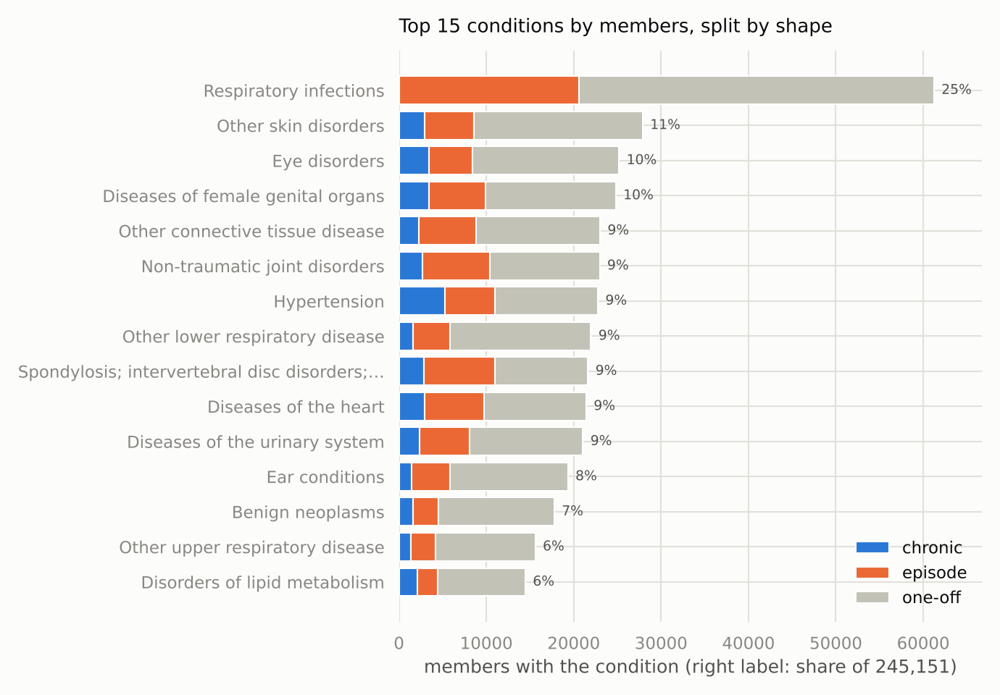
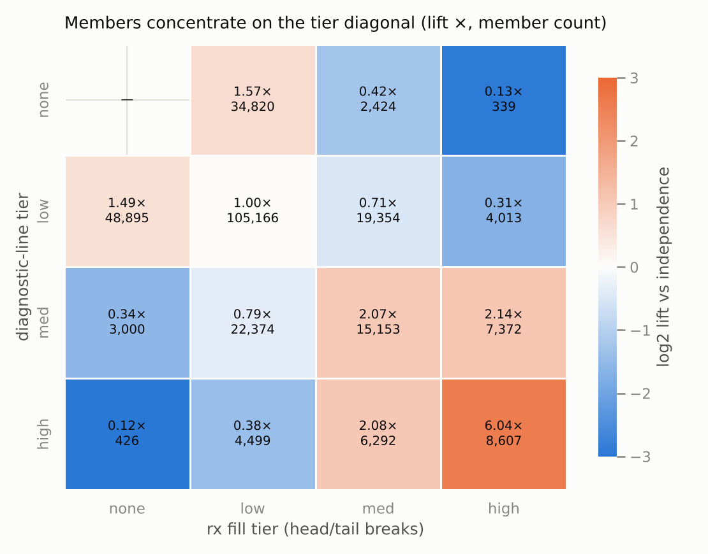
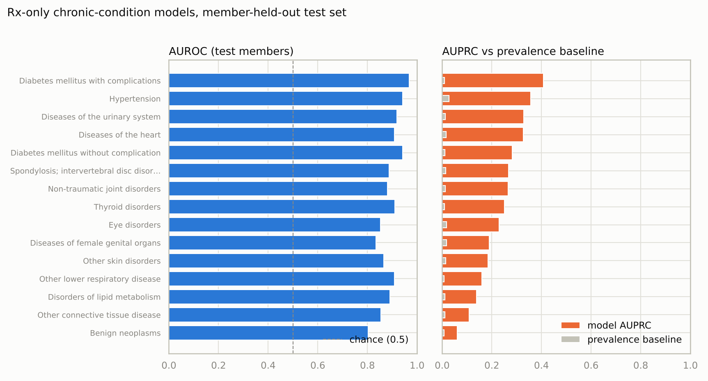
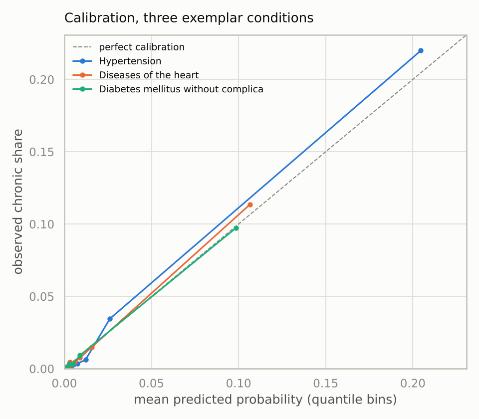

# Data analysis report: classifying member health status from medical and prescription drug usage

*2026-11-02 · Lauren Jackson · for Oscar reviewers*

## 1. Executive summary

Oscar's case study asks for a way to infer members' health issues from diagnosis and
prescription data, for 200,000 simulated members over three years. I characterized each
member as a set of clinical conditions shaped by their claim-date pattern (one-off,
episode, or chronic) and found a population that is mostly light contact around a
chronic core: 15.2% of the 245,151 members with usable claims carry at least one chronic
condition. A simple per-condition logistic regression then recovers chronic status from
prescription fills alone, at an AUROC (area under the ROC curve) of 0.80 to 0.97,
depending on how drug-managed the condition is. I recommend shipping the drug-side model as ranked outreach lists for the
37,583 members who have fills but no claims, and requesting enrollment data before any
utilization number is read as sickness rather than exposure time.

## 2. Introduction & background

The brief poses two linked problems. First, characterize each member's health status
from outpatient claims, using the CCS mapping from ICD-10 diagnosis codes to clinical
categories; the stated bar is a useful, robust description such as "member xyz had
cancer and a broken leg." Second, infer that same status from prescription drug data
alone, as a simple model that could be applied to members for whom only drug data is
available. Oscar's motivating uses are finding members who aren't receiving needed care,
flagging unusual care patterns, and anticipating future care needs.

The questions I set out to answer, in order: what does "health status" mean concretely
in this data; how prevalent is each condition and in what temporal shape; how do the
claims and prescription feeds relate per member; and how much of the claims-side status
is recoverable from fills alone.

## 3. Data overview & methodology

**Data sources.** Three files provided with the brief: claim lines with one diagnosis
per member per day (1,919,983 rows), a CCS mapping of ICD-10 codes to a three-level
clinical hierarchy (72,167 rows), and filled prescriptions carrying a drug
category → group → class hierarchy (3,005,934 rows).

**Timeframe.** All statistics use the window 2015-09-01 to 2018-06-04, the intersection
of real coverage: claims ramp up from September 2015, prescriptions reach back to
December 2013, and both feeds taper out together over April and May 2018. A claims
maximum date of December 2018 turned out to be six stray rows, not coverage.

**Sample size.** 282,734 members appear in the window: 192,830 in both feeds, 52,321
with claims only, 37,583 with prescriptions only. The characterization covers the
245,151 members with at least one usable claim line.

**Data cleaning.** The files are deliberately dirty, so every exclusion is counted
rather than silent. I dropped 24 claim rows with null dates and 207 rows outside the
window (including 1899 sentinel dates), losing 15 members. Diagnosis codes were
normalized (dots stripped, uppercased) before joining to CCS, which maps 99.9% of rows;
the 1,990 unmapped rows across 216 junk-heavy codes (`99999`, `KHDX`, `000`) are kept as
an explicit bucket. Codes are read as strings throughout because drug codes carry
meaningful leading zeros.

**Analytical methods, in steps.** (1) Bucket each claim line: condition, symptom
(R-codes, kept as their own track), or excluded administrative content (Z-codes,
immunizations/screening, the CCS residual chapter, unmapped). (2) Shape each
member-condition pair from its distinct claim dates: one-off (one date), episode (two
or more dates within 180 days), chronic (a span beyond 180 days), with injuries and
infections capped at episode so that reinfection never reads as chronicity. (3) Tier
each member's diagnostic-line and fill volumes by head/tail breaks (cut at the mean,
then at the mean of what lies above), with zero its own tier and a flag above the 99th
percentile. (4) For the drug-side model, fit one L2 logistic regression per condition
for the 15 conditions with the most chronic members: labels from claims only, features
from prescriptions only (log fill counts over 669 drug classes plus totals), split
80/20 by member, scored by AUROC and AUPRC (area under the precision-recall curve)
against the prevalence baseline.

## 4. Results & findings

**The population mix.** Of the 245,151 characterized members, 41.5% have only one-off
conditions, 31.5% have at least one episode but nothing chronic, 15.2% have a chronic
condition, 9.8% show only administrative or unmapped lines, and 2.0% show only
symptoms. The median member has 2 conditions; the 90th percentile has 6; the maximum
is 84.

**Prevalence and shape are different stories.** Respiratory infections touch the most
members (25%), yet none of that is chronic once the reinfection cap applies: 11,091
member-condition pairs were held at episode, 8,600 of them respiratory. Hypertension
reaches 9.3% of members and carries the largest chronic count, 5,223 members. Figure 1
shows the fifteen most prevalent conditions with their shape split.

*Figure 1: The fifteen most prevalent conditions among 245,151 members, split by shape
(chronic / episode / one-off). Percentages give each condition's reach.*

**The two feeds agree, and their joint extreme is a real segment.** Members concentrate
on the diagonal of the diagnostic-tier × fill-tier table: the high-high cell holds
8,607 members at 6.04 times what independence would predict, while the discordant
corners are suppressed to 0.12 to 0.13 (Figure 2). 518 members sit above the 99th
percentile on both axes, against 19.6 expected under independence. The off-diagonal
cells are small but meaningful: 339 members fill at the high tier with zero claims and
426 claim at the high tier with zero fills.

*Figure 2: Member counts and lift versus independence across diagnostic-line and fill
tiers. Tiers come from head/tail breaks; zero activity is its own tier.*

**Symptoms without a diagnosis.** 50,525 members (20.6%) have R-code symptom lines;
4,941 of them have symptoms and no condition at all, led by abdominal pain, allergic
reactions, and malaise, and 3,491 members have a symptom track spanning more than 180
days. One masked example: no conditions; symptoms on 8 days (persistent); 8 claim days
from 2016-07 to 2017-01.

**The drug-side model.** Test-set AUROC runs from 0.803 (benign neoplasms) to 0.968
(diabetes with complications); AUPRC beats the prevalence baseline by 8 to 41 times on
every condition (Figure 3). Performance follows how drug-managed a condition is, and
the learned coefficients match the pharmacology: ACE-inhibitor and ARB combinations for
hypertension, biguanides and SGLT2 inhibitors for diabetes, antithyroid agents for
thyroid disorders. Calibration tracks the diagonal for the three conditions I checked;
the largest miss is hypertension's top decile, which runs slightly under (20.5%
predicted, 22.0% observed; Figure 4). Applied to the
37,583 prescription-only members, the scores rank well: the 530 such members with three
or more antidiabetic fills get a median predicted diabetes probability 40 times the
rest. Absolute probabilities stay low (median 0.027) because the chronic label is rare
and partly reflects claims engagement these members don't have.

*Figure 3: Per-condition AUROC (left) and AUPRC against the prevalence baseline
(right) on the member-held-out test set.*

*Figure 4: Calibration for three exemplar conditions, quantile-binned.*

## 5. Discussion & limitations

The shape split is what makes the characterization readable. Without it, the
prevalence table is an urgent-care log and respiratory infections look like the
population's biggest problem; with it, the chronic core (hypertension, diabetes, heart
disease, thyroid) surfaces, and that core is exactly where fills carry the most signal.
The model's ordering confirms the EDA's predictability map: pharmacies see drug-managed
chronic conditions two to three times as often as clinics do, while injuries and
neoplasms leave little pharmacy trace. For Oscar's stated uses, the symptom-only
members and the discordant tier cells are the most actionable products: members in
contact with care but without explained diagnoses, and members heavy in one feed and
absent from the other, are concrete "not receiving required care" and "unusual pattern"
candidates.

Limitations, in rough order of weight. Enrollment spans are unobserved, so a silent
member may be healthy or gone, and all volumes conflate sickness with exposure time.
The chronic label is a proxy ("sustained claims contact") that misses the undiagnosed
and anyone managed outside these feeds. The model performs same-period inference, which
overstates what a deployment-time model predicting from fills ahead of claims would
achieve. Conditions first appearing within 180 days of the window's end cannot reach
chronic (right-censoring). The reinfection cap costs tuberculosis and spinal cord
injury any chance of reading chronic, while HIV and hepatitis are protected by an
exemption; the exemption list is a judgment call Oscar's clinicians should own. Fills
cannot be tied to a specific diagnosis in this data, so drug-condition attribution is
approximate. And the data is synthetic with planted dirt, so effect sizes should not be
read as epidemiology.

## 6. Recommendations & action items

1. **Ship the drug-side model as ranked lists, not thresholded labels.** Hand care
   teams the top-k members per condition among the 37,583 prescription-only members,
   sized by expected counts (for example, roughly 242 expected chronic-hypertension
   members). Owner: this analysis, ready now. Monitor: contact-to-confirmation rate per
   list.
2. **Request enrollment/eligibility data.** No other addition buys more: it turns
   absence into evidence and volumes into rates. Owner: data ask to Oscar. Everything
   downstream improves.
3. **Re-fit prospectively before any deployment claim.** Features from years one and
   two, labels from year three, so the metric matches the use. Owner: next analysis
   session, roughly half a day.
4. **Add persistence features** (sustained therapy: three or more fills spanning at
   least 90 days; refill-gap patterns): the EDA showed they separate chronic therapy
   from one-offs better than raw counts, and they should lift exactly the conditions
   that matter. Owner: next analysis session.
5. **Put the cap-exemption list in clinical hands.** Confirm or amend the
   infections-and-injuries-never-chronic rule and its named exemptions before the
   definition is treated as policy.

---

*Reproduction: `scripts/build_health_status.py`, `scripts/report_figures.py`,
`scripts/build_rx_model.py`, run in that order on the canonical window; every number
above also executes in `notebooks/01_final_report.ipynb`. Policy constants live in
`src/oscar_cs/health_status.py`. The companion write-up in the house skeleton is
`reports/2026-11-02_final-report.md`; structure per
`references/report-outline-template.md`.*
