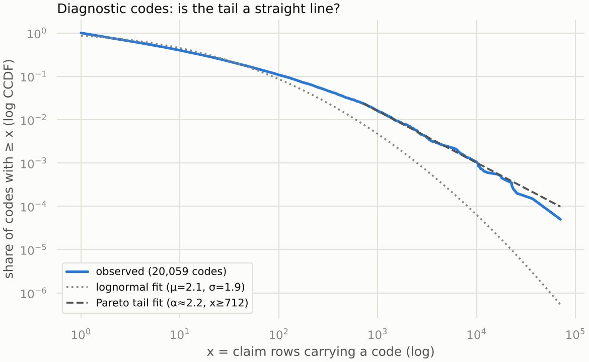
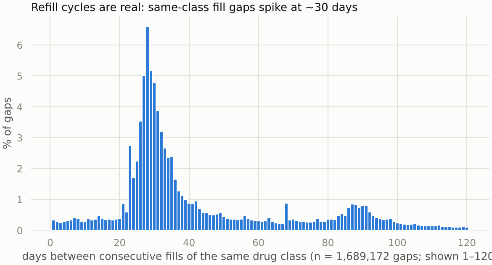
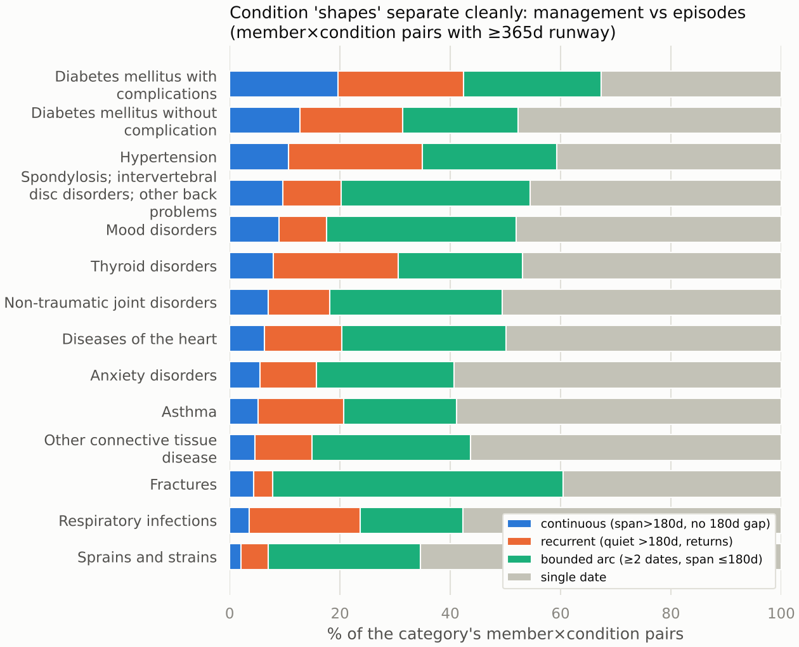
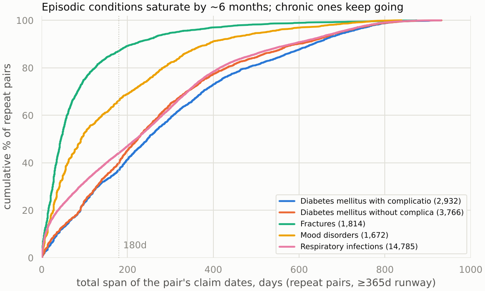
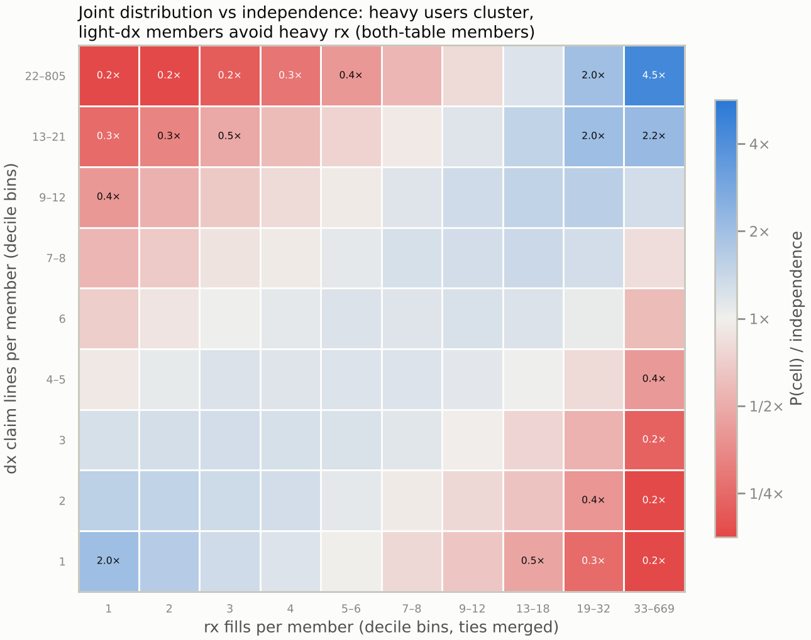
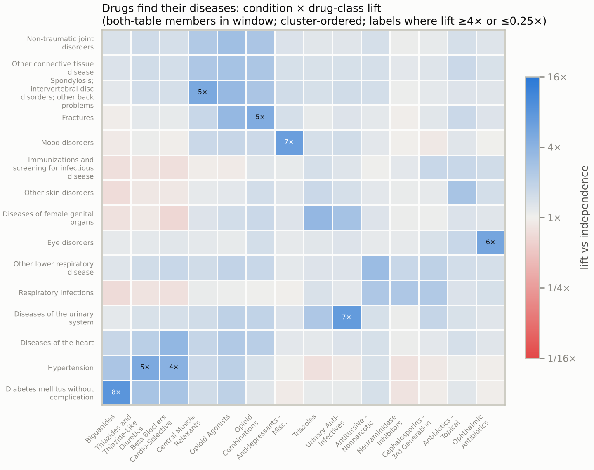

# EDA before the definition: what two days of exploration established

Milestone write-up of the 2026-11-01/02 EDA sessions, for re-cutting the health-status
definition next session. Every number reproduces from the scripts in `scripts/eda/` at
this commit; the appendix maps claims to scripts.

## TL;DR

The dataset is wired with real clinical logic: fills follow symptom visits like
diagnosis visits (median gap 2 days), specific drugs find their diseases (metformin
co-occurs with diabetes at 8x chance), and refills run on a measurable 30-day cycle.
The population is bigger than documented (291,611 members, essentially the whole id
space; nobody has zero events) and both feeds taper out together in spring 2018, so we
adopted one canonical window, 2015-09-01 to 2018-06-04. The chronic rule from the
requirement-1 draft decomposes badly: only 16.3% of the pairs it flags are continuous
management, while 44.2% are bounded arcs like fracture follow-ups. Claims and rx
utilization correlate at rho = 0.5 however measured, with symmetric discordant extremes
(~3% of members heavy on one side and absent on the other). The definition is reopened
with clear empirical direction; binning (low/med/high) still needs a principled method,
since median and quartile cuts both failed on these tied, heavy-tailed counts.

## Decisions made (logged in memory/decisions.md)

- Canonical analysis window [2015-09-01, 2018-06-04] for all cross-table and population
  stats. Pricing it exposed that the documented "claims to 2018-12" end was 6 stray
  rows; both feeds taper over Apr-May 2018. In-window universe: 282,734 members =
  192,830 both + 52,321 claims-only + 37,583 rx-only.
- Median and quartile tier cuts rejected. Median splits leave a near-empty "mid" bin
  (integer ties); pooled quartiles collapse because the median pair on both sides is a
  single touch. Next session designs principled low/med/high bins for diagnostic claims,
  fill claims, and the contingency table.
- Proposed and pending: the outlier policy (keep everyone, percentile fences, flag >p99;
  finding 8) and everything about the health-status definition itself.

## Findings

1. **The population is the id space.** 291,611 of 291,614 member ids appear somewhere;
   independence between the two tables would leave ~8,100 members with no events,
   observed 3. There is no observable zero-utilization population, and the brief's
   "200,000 members" is nominal. Claims-only (52,321) and rx-only (37,583) members are
   real segments, spread uniformly through the id range.

2. **The dirt is structured.** Null dates hit 24 members once each, carrying ordinary
   codes. Junk diagnosis codes split into three families: numeric placeholders
   (`99999`, 1,578 rows over 983 members), letter garbage (`KHDX`), and 187 valid-shaped
   ICD codes the mapping lacks, mostly 7th-character truncations that recur within
   single members. Zero exact duplicate claim lines exist in 1.92M rows, so a claims row
   is a distinct member-day-diagnosis fact and no dedup step is needed.

3. **Code usage is heavy-headed; group before modeling.** The top 180 diagnosis codes
   carry 50% of claim rows (20,059 distinct); drug classes saturate at top 24 = 50% of
   fills (669 distinct) while NDCs are hopeless (top 10 = 4%). Diagnosis-code
   frequencies have a genuine Pareto tail (alpha = 2.2 above ~712 rows/code, KS 0.024)
   over a lognormal body; drug classes read lognormal with a truncated tail.

   

4. **Rx is glued to claims, and the glue is clinical.** For members in both tables, the
   median fill sits 11 days after the last claim; only 7.7% of fills lack any claim in
   the prior year, and those skew to maintenance therapy (vaccines, contraceptives,
   psych meds) while acute categories dispense same-day. Symptom-only (R-code) visit
   days are followed by a fill almost as often as diagnosis days (48.1% vs 51.8% within
   7 days); checkup-only (Z-code) days much less (37.2%, median 5 days). What gets
   filled makes sense: ulcer drugs after abdominal-pain days, contraceptives after gyn
   exams. In the other direction, the least-filled diagnoses are pregnancy, screenings,
   injuries, and procedure-managed neoplasms; the most-filled are COPD, diabetes, ADHD,
   hypertension, and asthma. That ranking is requirement 2's feasibility map, measured
   rather than assumed from drug priors.

5. **Refills have mechanics.** 41.9% of same-class consecutive fill gaps land in the
   25-35 day band (median 33 days) with 60- and 90-day harmonics: a real refill cycle.
   21.8% of member-class pairs are sustained (3+ fills over 90+ days) and 36.7% of rx
   members have at least one sustained class. Per-class depth stratifies cleanly:
   SSRIs, statins and ACE inhibitors have median 3 fills per member; antibiotics and
   vaccines have median 1 with even p75 = 1. One caveat: PRN therapies (inhalers) look
   acute by fill counts although the condition is chronic.

   

6. **Claims repetition has shapes, and the current chronic rule mixes them.**
   Classifying member-condition pairs (365+ days of runway) by date pattern: 59.8%
   single date, 23.6% bounded arc (span <= 180d), 11.8% recurrent (returns after a
   180+ day quiet gap), 4.9% continuous. The requirement-1 chronic rule (2+ dates, 30+
   days apart) decomposes into 44.2% arc + 39.4% recurrent + 16.3% continuous: five of
   six flags are not continuous management. Category signatures match clinic sense:
   fractures are 52.6% arc with a ~10-day follow-up cadence; diabetes, hypertension and
   thyroid run 30-43% continuous-plus-recurrent with 60-92 day check-in gaps. Two traps:
   respiratory infections fake long spans through reinfection, and mood/anxiety
   disorders look episodic in claims while their chronicity shows up in rx
   (antidepressants are among the most sustained classes). Claims shape needs rx
   corroboration.

   

   

7. **The two sides agree at rho = 0.5, and the disagreements carry the information.**
   All four metric pairings (volume/distinct x claims/rx) land between 0.49 and 0.54.
   The joint decile distribution runs 2.0x over independence in the light-light corner
   and 4.5x in the heavy-heavy corner, with discordant corners suppressed to 0.11x. The
   discordant extremes are symmetric and real: ~8,300 members are heavy fillers with
   zero claims and ~8,100 are heavy claimants with zero fills (about 3% each). At the
   condition-class level, lift confirms the wiring: metformin x diabetes 8x,
   antidepressants x mood disorders 7x, urinary anti-infectives x urinary disease 7x,
   thiazides x hypertension 5x. Injuries carry only non-specific analgesia.

   

   

8. **Volumes are smooth heavy tails; outliers are a segment, not noise.** Claim lines
   per member: p50 = 4, p90 = 18, p99 = 63, max 914. Fills: p50 = 5, p90 = 29,
   p99 = 94, max 669. Raw IQR fences would flag ~10% of members and are useless here.
   518 members sit above p99 on both axes versus ~19 expected under independence (27x):
   extreme utilization is jointly structured. Proposed policy, pending sign-off: remove
   nobody, default to rank/quantile statistics, cap displays at p99 with explicit
   labels, and flag >p99 members as a high-utilizer segment, since the brief asks for
   exactly these unusual patterns.

## What the next session decides

1. Binning: principled low/med/high for diagnostic-claim volume, fill volume, and the
   contingency table. Candidates to evaluate: log-scale natural breaks, mixture models,
   or clinically anchored cuts. Median and quartile methods are out.
2. The health-status definition, with the evidence stacked: ternary shapes (chronic /
   episode / one-off) are supported; "recurrent" needs rx corroboration or category
   priors to separate returning-chronic from repeat-acute; immunizations and screening
   now has five independent strikes against counting as a condition; the symptom-only
   tier question stands; and rx persistence (sustained classes) is the higher-resolution
   chronicity signal for drug-managed conditions, since pharmacies see chronic members
   2-3x more often than clinics do.
3. Requirement 2 setup follows from the definition: labels, the 37,583 rx-only members
   as the scoring population, and the predictability tiers from finding 4.

## Open questions

- Enrollment spans are still the biggest unknown: volume conflates sickness with
  exposure time, and nothing in the data separates them.
- The isolated spike at a 68-day inter-fill gap and the 3 unused member ids look like
  generator artifacts; neither matters analytically.
- Whether a fill "belongs" to a diagnosis can only be approximated (any-fill windows or
  class-condition maps); the data has no explicit link.

## Appendix: reproduction map

All scripts live in `scripts/eda/` and run against the parquet cache under the canonical
window. Figures sit in `reports/figures/` with the prefix `2026-11-02_eda-session_`.

| script | produces |
|---|---|
| `eda_pass1.py` | id space, junk/missingness patterns, duplicate check, CCS cardinality |
| `eda_window_pricing.py` | canonical-window costs, in-window populations, taper evidence |
| `eda_zr_to_fills.py` | Z/R visit-day to fill linkage (finding 4) |
| `eda_dx_no_fill.py` | which diagnoses go unfilled (finding 4) |
| `eda_fills_no_dx.py` | which fills lack preceding claims (finding 4) |
| `eda_rx_pass.py` | fills/member, hierarchy usage, persistence, gap cycle + 4 figures |
| `eda_freq_single.py`, `eda_freq_pareto.py`, `eda_rx_freq_2series.py` | code-frequency views |
| `eda_pareto_test.py` | CCDF + Pareto/lognormal fits (finding 3) |
| `eda_repetition.py` | repetition shapes, chronic-rule decomposition + 2 figures |
| `eda_rx_dx_joint.py` | class tables, refill buckets, lift heatmap (finding 7) |
| `eda_prob_dist.py` | volume distributions, outlier diagnostics, joint deciles (finding 8) |
| `eda_volume_tiers.py` | median tiers, contingency, four-way correlations (finding 7) |
| `eda_pair_depth.py` | pooled bins + per-group quantiles of pair depth (finding 5) |

Caveats that travel with every number: Apr-May 2018 is taper-thin in both tables;
enrollment is unobserved (censoring); fill-to-diagnosis attribution is approximate; the
data is synthetic with deliberate dirt.
