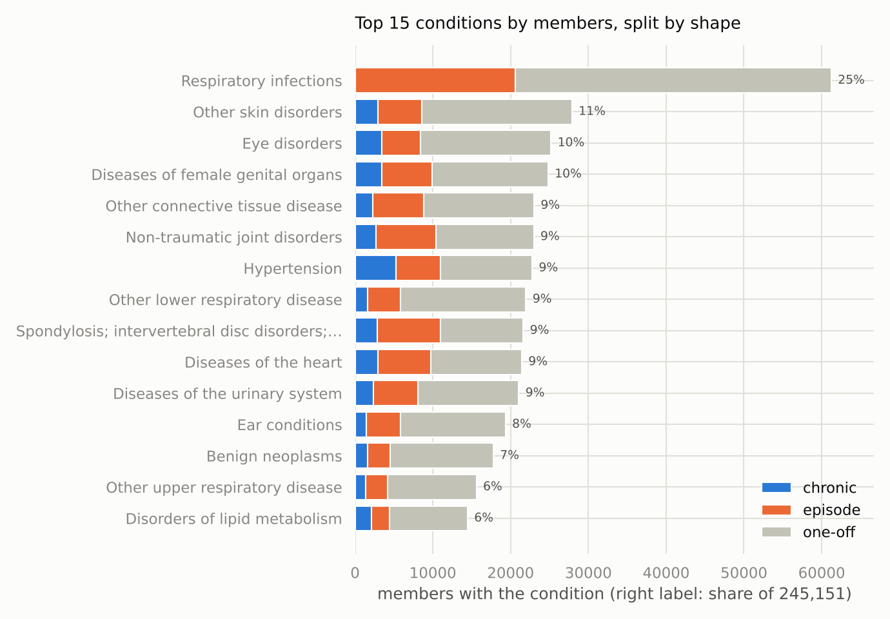
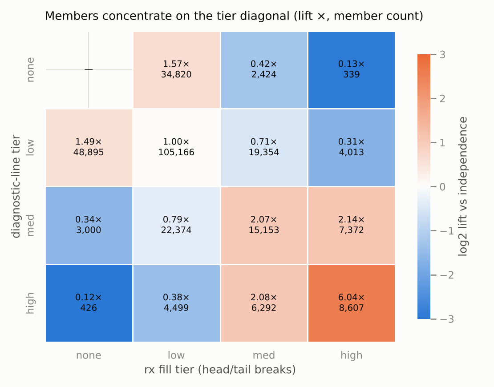
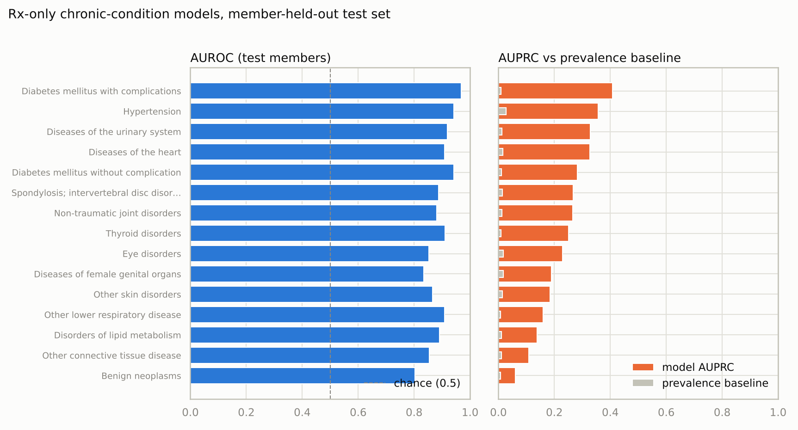
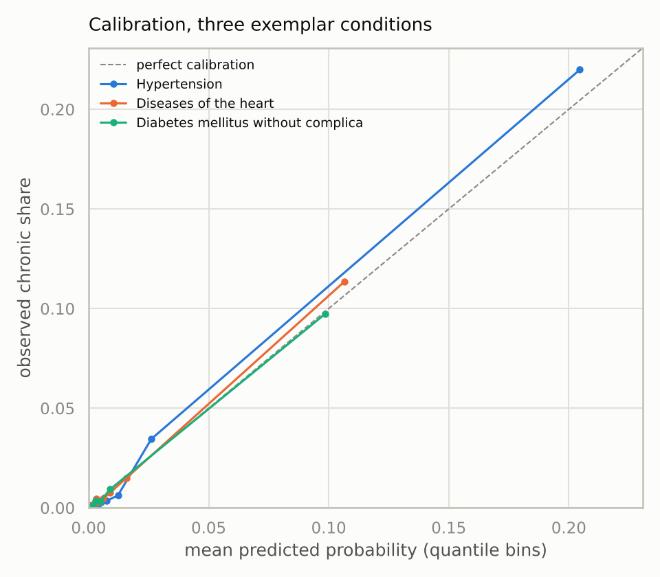

# Classifying member health status from medical and prescription drug usage

*2026-11-02 · data window 2015-09-01 → 2018-06-04 · for Oscar reviewers*

## TL;DR

I characterized each of 245,151 members with usable claims as a set of CCS level-2
conditions, each shaped by its claim-date pattern: one-off, episode (a bounded burst of
care), or chronic (contact spanning more than 180 days). 15.2% of members carry at least
one chronic condition; the median member has 2 conditions and 4 claim lines over almost
three years. From prescription fills alone, one logistic regression per condition
recovers chronic status with an AUROC (area under the ROC curve) of 0.80 to 0.97 and
an AUPRC (area under the precision-recall curve) 8 to 41 times the prevalence
baseline, best for drug-managed conditions like diabetes and hypertension, and the
learned coefficients are the pharmacology you'd write down by hand. Claims and drug
utilization are jointly structured: members in the top tier on both axes run 6 times
independence, and 518 members sit above the 99th percentile on both, against 19.6
expected if the two were unrelated. That extreme tail is a real segment of the
population, not noise to trim.

## Approach, and what I ruled out

**Unit.** Member × CCS level-2 condition. Level 1 (18 chapters) hides which condition a
member has; level 3 splits the same condition across sparse cells. A characterization at
level 2 round-trips to a sentence ("member A: chronic lymphoma; one-off migraine"),
which is the bar the brief sets.

**Shapes.** A code on one day is a clinician's note, not a disease. I shape each
member-condition pair by its distinct claim dates: one-off (1 date), episode (2+ dates
inside 180 days), chronic (span beyond 180 days). This replaced my first chronic rule
(2+ dates at least 30 days apart) after EDA showed that 44% of what it flagged were
bounded arcs: fracture-like care sequences, not ongoing conditions.

**The reinfection trap.** Repeated respiratory infections across two winters span more
than 180 days, but that is reinfection, not chronicity. Injuries and the infection
categories are capped at episode: 11,091 member-condition pairs were held back from
chronic, 8,600 of them respiratory infections. Two accepted costs worth naming:
tuberculosis (filed under "Bacterial infection") and spinal cord injury can never read
chronic here. "Viral infection" is exempt from the cap because HIV and hepatitis live
inside it.

**What is not a condition.** Z-codes (250,060 lines of encounters, screenings and
administrative contact) and immunizations/screening (29,164 lines) are excluded; one of
them would otherwise be the #1 "condition," touching 52.9% of members. R-codes are
different. They are symptoms that could mean something, so they get their own track:
present for 50,525 members (20.6%), persistent (a span over 180 days) for 3,491. The
Residual chapter (31,625 lines) and unmapped codes (1,990 lines, 216 distinct codes,
0.1% of rows; top offenders `99999`, `KHDX`, `000`) are counted buckets rather than
silent drops. Normalized joining (strip dots, uppercase) maps 99.9% of claim rows to
CCS.

**Utilization tiers.** Low/med/high by head/tail breaks: cut at the mean of members
with any activity (7.8 claim lines; 11.7 fills), then cut the above-mean group at its
own mean (20.9; 31.9). Zero is its own bin, and a >p99 flag (63 lines / 94 fills) sits
on top. Quartiles collapse on this data because the median member×condition pair is a
single touch; means can't be swallowed by ties. Ruled out overall: a single severity
score (hides which conditions), utilization-only clustering (not clinically readable),
and raw-scale outlier fences (IQR would flag ~10% of members in tails this heavy).

## Findings

**1. The population is mostly light contact around a chronic core.** Of 245,151 claims
members: 41.5% have only one-off conditions, 31.5% have at least one episode but nothing
chronic, 15.2% have a chronic condition, 9.8% show only administrative or unmapped
lines, and 2.0% only symptoms. Conditions per member: median 2, p90 = 6, max 84.

**2. "Most common" and "most burdened" are different lists, and the shape split is what
separates them.** Respiratory infections touch 25% of members, all of it episode or
one-off once the reinfection cap applies. Hypertension, at 9.3% of members, carries the
largest chronic count (5,223 members). Without shapes, the prevalence table reads like
an urgent-care log; with them, the chronic burden surfaces.

**3. Claims and drug utilization agree, and their joint extreme is a real segment.**
Tier membership concentrates on the diagonal: high-dx × high-rx holds 8,607 members at
6.04 times independence, while the discordant corners are suppressed to 0.12 to 0.13.
The >p99 flags compound: 518 members above p99 on both axes against 19.6 expected. The
off-diagonal is informative too: 339 members fill drugs at the high tier with zero
claims, and 426 claim at the high tier with zero fills. Those are the unusual care
patterns the brief asks about, and they only become visible when the two feeds are
crossed.

**4. 4,941 members have symptoms and no explained condition.** Symptom-only members
(R-codes, no condition flag) are a small segment led by abdominal pain, allergic
reactions and malaise; 3,491 members overall have a persistent symptom spanning more
than 180 days. Example (masked): *Member C: no conditions; symptoms on 8 days
(persistent); 8 claim days 2016-07 → 2017-01.* That is a member in contact with care
and getting no diagnosis that CCS counts, which is a plausible picture of "not receiving
required medical care."

## The drug-only model (requirement 2)

**Setup.** Labels: the chronic flags above, for the 15 conditions with the most chronic
members, from claims/CCS only, so no model input ever defines its own target. Features:
prescriptions only. Each member gets log1p fill counts over the 669 observed drug
classes plus total fills and distinct classes. Population: the 192,830 members present
in both feeds, split 80/20 by member, never by row. One L2 logistic regression per
condition, one-vs-rest, because members carry several conditions at once. With positives
at 0.7 to 2.7%, accuracy says nothing, so I report AUROC and AUPRC against the
prevalence baseline. This is same-period inference (fills and status share the window),
not prospective prediction; the two need different splits and make different claims.

**Results.** Test-set AUROC runs 0.80 to 0.97 and AUPRC beats prevalence 8 to 41 times
everywhere. The ordering follows how drug-managed a condition is, as the EDA predicted:
diabetes with complications leads (AUROC 0.968, AUPRC 0.408 against 0.010 base), with
hypertension and heart disease close behind; benign neoplasms trail (0.803, 0.061
against 0.007) because little in a pharmacy history marks them. Calibration tracks the
diagonal for the three conditions I checked; the largest miss is hypertension's top
decile, which runs slightly under (20.5% predicted, 22.0% observed). The coefficients are a free sanity check: ACE-inhibitor and ARB combinations
for hypertension, biguanides and SGLT2 inhibitors for diabetes, antithyroid agents for
thyroid. The model found the formulary without a claims feature in reach. An ablation answers the obvious objection, that sick members simply fill more prescriptions: refit on total fills and distinct classes alone, every condition loses ground, and the full model multiplies the utilization-only AUPRC by 2.0 to 5.8 times for 14 of the 15 conditions. The exception is other connective tissue disease (1.3 times), whose score mostly reflects overall volume; I would not claim drug-specific signal for it.

Applied to the 37,583 rx-only members (fills, zero claims, the population this model is
for), the scores rank far better than they threshold. The 530 rx-only members with 3+
antidiabetic fills get a median predicted diabetes probability 40 times the rest, but
absolute probabilities stay low (median 0.027), because the chronic label is rare and
partly measures claims engagement these members don't have. I'd ship ranked outreach
lists and expected counts (for example, ~242 expected chronic-hypertension members in
this group), not a 0.5 cutoff.

**Limitations.** The label is "chronic claims contact," a proxy that misses the
undiagnosed and anyone managed outside these feeds. Same-period inference overstates
what a deployment-time model would see. Enrollment spans are unobserved, so absence of
claims is ambiguous between healthy and gone. Conditions first appearing within 180 days
of the window's end can't reach chronic (right-censoring). No hyperparameter search, and
15 conditions rather than all of them.

## What more time buys

1. **A prospective split**: features from years 1 and 2, labels from year 3, turning
   inference into the prediction a new-member model actually performs.
2. **Decision thresholds per condition**: precision/recall trade-offs costed for an
   outreach use case, instead of raw probabilities.
3. **Persistence features**: sustained-therapy flags (3+ fills spanning 90+ days) and
   refill-gap patterns, which the EDA showed separate chronic therapy from one-offs
   better than raw counts do.
4. **Wider labels**: beyond the top 15, guided by the predictability map (strong for
   drug-managed conditions, weak for injuries and neoplasms, which need claims).
5. **Enrollment inference**: gap-based enrollment spans to soften the censoring caveat
   and put member-months in denominators.

## Open questions

- Is there an enrollment or eligibility table? Without one, "no claims" is unreadable.
- Should drug persistence co-define chronic status? Psychiatric chronicity lives almost
  entirely in fills here; a claims-only label understates it.
- Is the reinfection cap's cost (TB and spinal cord injury can't be chronic) acceptable,
  or should those get named exemptions like HIV and hepatitis?
- Fills can't be tied to a specific diagnosis in this data. Is an approximate
  class-to-condition map acceptable for attribution questions?

## Appendix: reproduction and caveats

Every number above reproduces from the committed scripts, in order:

| step | script | outputs |
|---|---|---|
| characterization | `scripts/build_health_status.py` | `data/processed/member_{conditions,symptoms,health_status,tiers}.parquet`, `health_status_stats.json` |
| figures 1–2 | `scripts/report_figures.py` | `reports/figures/2026-11-02_final_fig01/02` |
| model + figures 3–4 | `scripts/build_rx_model.py` | `rx_model_metrics.json`, `rx_only_scores.parquet`, fig03/04 |
| utilization ablation | `scripts/check_utilization_baseline.py` | `utilization_ablation.json` |

Policy constants (window, shape rule, cap scope, tier rule) live in
`src/oscar_cs/health_status.py`; the SQL takes them as parameters. Unit tests
(`tests/test_health_status.py`) pin the shape boundary (180/181 days), the cap, the
head/tail cuts, and SQL↔Python agreement.

Exclusion accounting: 24 null-date rows + 201 pre-window + 6 post-window = 231 claim
rows (0.012%) and 15 members excluded. The canonical window is the intersection of real
coverage in the two feeds (both taper out over Apr–May 2018; rx reaches back to 2013-12
and that history never mixes in unlabeled). The data is synthetic and dirty by design
(1899 sentinel dates, junk codes, a quoted comma-embedded code); handling is documented
in `memory/data-quirks.md`. Member-level rows stay in local parquets, and the vignettes
here use masked labels. In-window populations: 282,734 members = 192,830 in both feeds
+ 52,321 claims-only + 37,583 rx-only.

Masked vignettes (the characterization's round-trip test):

- *Member A: chronic cancer of lymphatic and hematopoietic tissue, chronic lower
  gastrointestinal disorders; one-off migraine, one-off injury from external causes;
  symptoms on 1 day; 10 claim days 2016-05 → 2018-02.*
- *Member B: chronic cerebrovascular disease, heart disease, anxiety disorders (+31
  more); episodes including respiratory infections and fractures; 312 claim days
  2015-10 → 2017-01.* (Member B has no in-window fills, one of the 426 high-claims, zero-fill members.)
- *Member C: above, in finding 4.*
